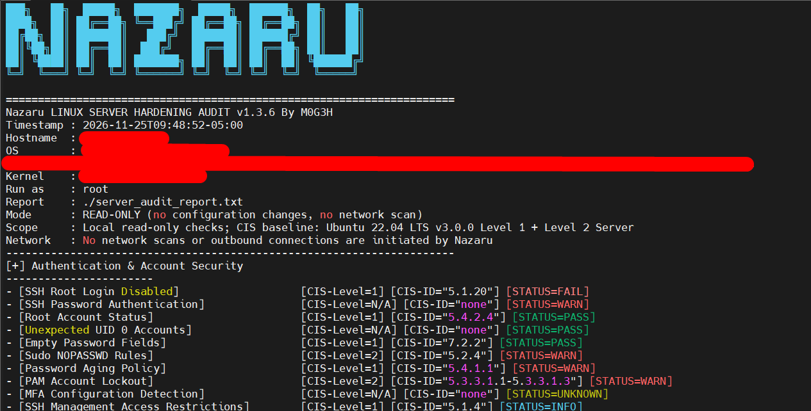

<p align="center">
  
</p>


## Origin of the Name – NAZARU
The name **NAZARU** is inspired by the ancient Akkadian words Naṣāru (to guard, protect, and preserve) and Nāṣiru (guardian or protector).

Inspired by these meanings, NAZARU represents the mission of the tool: to identify security weaknesses, protect Linux systems, and help preserve their integrity.


---

## 📌 Project Description

**NAZARU** is a local, read-only Linux security auditing tool. It performs **153 security checks** covering areas such as authentication, SSH, network services, file permissions, system services, logging, and system integrity.

The checks are mapped to the **CIS Ubuntu Linux 22.04 LTS Benchmark v3.0.0 (Level 1 and Level 2 Server)**.

NAZARU does not automatically change system configurations, perform network scans, or initiate outbound connections.

---

## 🖥️ Project View

<p align="center">
  
</p>

---

## 👥 Who Is NAZARU For?

| Audience | Purpose |
|---|---|
| 🔐 Security Engineers | Identify Linux security weaknesses and hardening gaps |
| 🧪 Penetration Testers | Perform initial security configuration assessments |
| 🖥️ Linux System Administrators | Review server configurations and security settings |
| 🛡️ Blue Team Members | Support host security assessments and defensive reviews |
| 🏢 IT Security Teams | Perform repeatable Linux security checks |
| 🎓 Security Students | Learn Linux hardening concepts and security auditing |

---

## ✨ Key Advantages

- **🔍 153 Security Checks** — Evaluates 40 different areas of Linux system security.
- **📝 Test ID** - CIS Benchmark level and ID shown with test results.
- **⚡ Lightweight** — Implemented in Bash without requiring a large application stack.
- **🔒 Local Execution** — Performs assessments directly on the target Linux system.
- **📊 Clear Results** — Uses structured security statuses to make findings easy to understand.
- **📝 Report Generation** — Text and XML report generation.
- **🎨 Readable Output** — Uses colored terminal output and a custom command-line banner.
- **🧩 Broad Coverage** — Examines authentication, SSH, network exposure, permissions, logging, monitoring, and more.
- **🚫 Read-Only Assessment** — Designed to inspect system security without intentionally modifying system settings.
- **📝 Modes** - Quiet mode and descriptions mode.


---

## 🔎 Security Assessment Coverage

NAZARU currently includes 40 security checks organized around the following areas:

| Category | Checks |
|---|---|
| 🔑 SSH Security | Root login, password authentication, management access restrictions |
| 👤 Account Security | Root account status, UID 0 accounts, empty passwords, administrative groups |
| 🔐 Authentication | Password aging, PAM lockout, MFA indicators |
| 🌐 Network Security | Listening sockets, Telnet, FTP, Samba, SNMP |
| 🔥 Firewall & Boot Security | Firewall status, reboot indicator, Secure Boot, GRUB protection |
| 🛡️ System Hardening | SELinux, AppArmor, automatic security updates |
| 📁 File System Security | Critical file permissions, SUID/SGID, world-writable files, capabilities |
| ⚙️ Persistence & Services | Cron access, startup scripts, enabled systemd services, cron persistence |
| 📋 Logging & Monitoring | Authentication logs, remote logging, privilege-change logging, EDR indicators |
| 💾 Integrity & Recovery | File integrity monitoring, backups, immutability indicators, restore-test evidence |

---

## 🚦 Result Classification

NAZARU uses six status levels to classify assessment results:

| Status | Meaning |
|---|---|
| 🟢 **PASS** | The check meets its defined security condition |
| 🟡 **WARN** | A potential security weakness or hardening gap was identified |
| 🔴 **FAIL** | A security condition was found to be non-compliant |
| 🔵 **INFO** | Informational result or inventory data |
| ⚪ **UNKNOWN** | The condition could not be reliably determined |
| ❗ **ERROR** | The check encountered an execution or inspection error |

> **Note:** `INFO` and `UNKNOWN` do not automatically indicate a security vulnerability. They may represent inventory information or conditions that cannot be verified locally.

---

## 🚀 How to install

### 1. Clone the Repository

```bash
git clone https://github.com/M0G3H/NAZARU.git
```

### 2. Enter the Project Directory

```bash
cd NAZARU
```

### 3. Make the Script Executable

```bash
chmod +x Nazaru
```

### 4. Run a Security Assessment

```bash
./Nazaru
```

Alternatively:

```bash
bash Nazaru
```

### 5. Save the Assessment Report

Provide a report filename as an argument:

```bash
./Nazaru nazaru_report.txt
```

The results will be displayed in the terminal and saved to the specified report file.

### 6. Run with Elevated Privileges (Optional)

```bash
sudo ./Nazaru
```

Running with elevated privileges can improve visibility into protected files, system configurations, and security settings. Use it when a more complete assessment is required.

---

## ⚠️ Important Notes

- NAZARU is intended for Linux systems.
- The CIS mapping is based on Ubuntu 22.04 LTS. When NAZARU runs on another distribution, it displays an OS warning and some benchmark results may not apply.
- Running without root privileges may prevent access to some protected files and settings.
- Review findings before making any system changes.
- Use NAZARU only on systems you own or are authorized to assess.

---


<p align="center">
  <strong>🛡️ NAZARU — See the Weakness. Strengthen the System.</strong>
</p>
